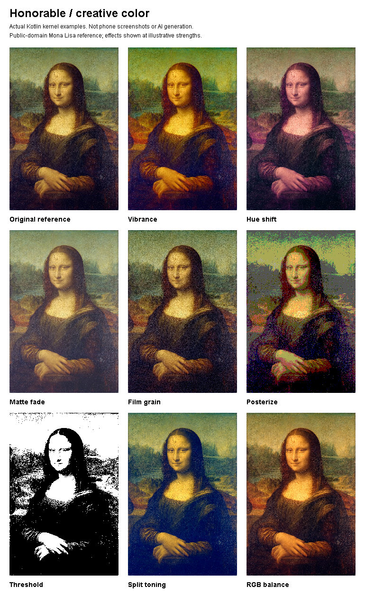

# More control over the look of a photo

October 24, 2026. Eight local editing tools have been added together as one creative-color suite. This is an addition to the existing editor, not a rebuild. The previous illustrated guide still covers the library, photo/video studios, drawing, montage and captions.

## What changed

Previously, the photo editor offered its existing exposure, contrast, saturation, white balance, tone curve, local light and finishing controls. This batch adds eight distinct color treatments. Each works through the same preview and copy-export renderer. They are available through **Tools → Creative color**, or the **Creative color** button under adjustments.

| Tool | What it does | A useful example |
| --- | --- | --- |
| Vibrance | Changes muted colors more strongly than already saturated colors | Give a quiet landscape more color without pushing every bright object equally |
| Hue shift | Rotates the colors in a picture | Explore a different color direction for an illustration or poster |
| Matte fade | Lifts the darkest tones while retaining white | Give a portrait softer, less crushed blacks |
| Film grain | Adds repeatable monochrome grain | Add texture to a clean digital image; its pattern stays stable between preview and export sizes |
| Posterize | Reduces each color channel to 2–16 levels | Turn a photograph into a bold graphic starting point |
| Threshold | Converts the image into a chosen black/white cutoff | Create a high-contrast stencil-style image |
| Split toning | Adds cool shadows and warm highlights | Give a picture a contrasting shadow/highlight palette |
| RGB channel balance | Adjusts red, green and blue strength separately | Correct or deliberately create a color cast |

These are deterministic editing tools. They do not generate new subjects, understand a prompt, rig a photograph or create a video.

## See the difference

These examples call the actual compiled Kotlin `PhotoCreativeKernel` used by the new editor stage. They are algorithm demonstrations, not phone screenshots or proof of physical-device operation. The input is the public-domain Mona Lisa reference credited in `../ui/images/README.md`; the app did not paint or generate it. The examples use deliberately visible strengths so the differences are easy to see.

## Try a softer portrait treatment

1. Open a photo you have permission to edit.
2. Open **Tools → Creative color → Matte fade**. Start around 20%, then Apply.
3. Try **Split toning** around 15–25% if you want warmer highlights and cooler shadows.
4. Add a little **Film grain** if the image feels too smooth.
5. Use Compare to inspect the original. Undo or redo each applied change as needed.
6. Save the adjustments in Saved looks if you want to reuse them on another photo.
7. Export a new PNG or JPEG copy. The original remains unchanged.

The tools combine in a fixed order: vibrance, hue, RGB balance, split toning, fade, grain, posterize and threshold. A strong posterize or threshold setting can hide subtler color work; disable it to see those changes again. Background replacement and text remain later in the existing pipeline. Applying a tool commits one undo step; Cancel leaves the current edit unchanged.

## What stays with your project

The new values participate in undo/redo, comparison, pending-export recovery and local saved looks. Older session and saved-look versions still load. Applying a saved look preserves the target photo's crop, rotation, local light, person selection and text. Reset returns the new tools to their neutral settings along with the other edits.

Additional export protection accepts a bounded list of imported originals from private creation workspaces. It checks open file identities before writing, including an alternate path to an original. This is groundwork for safe multi-photo creation; it is not a completed multi-photo painting workspace.

## Verification and limits

The build result and matching APK checksum belong in `../CREATIVE_COLOR_READINESS.md` and `../../executable/release.json`. Do not infer a new APK merely from this source document. Physical Android acceptance remains pending because no phone is available. iOS native editors, hosted account sign-in, generation and AI rigging remain unfinished.

**Count:** eight new editing tools in one creative-color workflow; zero new AI engines. This does not complete the requested 90-feature roadmap.
