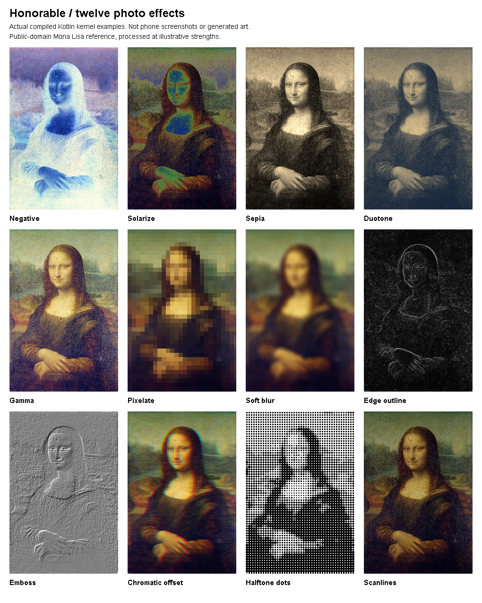

# Twenty more ways to finish a photo or video

October 24, 2026. This batch adds twelve photo effects and eight video editing workflows together. They extend the existing editors; no existing editor or search engine was replaced. These are local tools, not twenty AI models or generative features.

## Twelve photo effects

Open a photo, choose **Tools → Photo effects**, select a tool, adjust it and Apply. Cancel leaves the image unchanged. Each applied change participates in the existing Undo, Redo, Compare and Reset behavior.

| Tool | What it does |
| --- | --- |
| Negative | Inverts red, green and blue while keeping transparency |
| Solarize | Inverts channels above your chosen cutoff |
| Sepia | Mixes a warm monochrome treatment into the photo |
| Duotone | Maps dark and light tones between two editable colors |
| Gamma | Changes midtone brightness with a nonlinear curve |
| Pixelate | Averages colors into adjustable blocks; it is a creative effect, not secure redaction |
| Soft blur | Smooths the image with an adjustable separable box blur |
| Edge outline | Finds local contrast edges for a graphic outline treatment |
| Emboss | Turns directional contrast into a raised-surface effect |
| Chromatic offset | Separates red and blue samples horizontally |
| Halftone dots | Converts tone into black dots on white |
| Scanlines | Adds adjustable alternating dark bands |

The effects share the actual preview/export renderer and retain the alpha at each output position. Transparent neighbors do not contribute hidden colors to blur or pixelation. The effects run before person-background replacement and text, so text stays legible. Existing framing, rotation and original-file protection remain.

Saved looks include the effects. Earlier saved-look and lifecycle versions remain readable. The new state is also retained across undo/redo and pending-export recovery. A disabled effect does not prevent you from keeping its chosen duotone colors for later use.

These are actual kernel demonstrations on the credited public-domain Mona Lisa reference, not phone screenshots or AI-generated art. See `../ui/images/README.md` for provenance.

## Eight video workflows

Open the video editor and choose **Project → Batch editing**, or open its inspector. Every proposed change shows a review and applies as one undoable project edit. A stale project or account session invalidates the proposal.

| Workflow | What it does |
| --- | --- |
| Divide clip evenly | Splits the selected clip into equal source ranges; captions spanning a cut remain visible in both pieces |
| Limit clip lengths | Keeps centered excerpts up to a chosen playback length across the project; short clips stay short |
| Reverse clip order | Reverses the sequence of clips; footage within each clip still plays forward |
| Shuffle clip order | Proposes a new ordering of existing clips without creating or dropping footage |
| Repeat sequence | Repeats the whole edited sequence two to four times within project limits |
| Set all clip speeds | Sets the same supported playback speed across all clips in one action |
| Shift caption timing | Moves the selected clip's captions by a source-time offset; refuses offsets outside the clip instead of dropping cues |
| Reflow caption lines | Rewraps the selected clip's captions at a chosen character width without removing words or changing timing |

Clip color, transforms, source references and project music use the existing project model. Repeat also repeats titles and captions; the soundtrack remains the project soundtrack. Center trimming removes captions that no longer intersect the retained excerpt. Review the proposed duration and preview sound/timing before export.

Existing clip, source, caption-text and recoverable-draft limits still apply. A proposal that exceeds a project limit fails without changing the current project. Caption reflow never silently truncates text: use wider lines or shorten the cue when three lines are insufficient.

## A practical short-video workflow

1. Import a few clips and arrange the story.
2. Use Limit clip lengths to keep the pace consistent.
3. Divide a longer clip evenly if you want smaller pieces to arrange independently.
4. Add captions using the existing editor, then use Shift caption timing or Reflow caption lines where needed.
5. Preview the whole project. Undo any batch that does not suit the story.
6. Save the project and export a new video copy. Original media stays unchanged.

## What is verified

See `../CREATIVE20_READINESS.md` for the actual build, test and artifact results. A source change alone is not proof of a new APK, and compiled integration tests are not phone acceptance. Android device testing is unavailable here. Real generation, rigging, hosted sign-in and iOS native editor parity remain separate unfinished work.

**Count:** twenty additions—twelve photo-effect tools and eight video workflows. Presets, parameter choices, buttons, tests and the small prior-kernel allocation fix are not counted separately.
